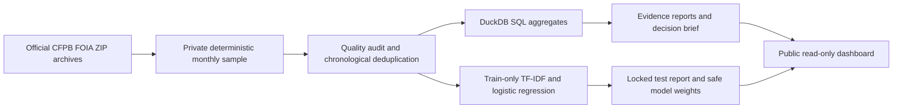

# Customer Feedback Intelligence

**[Open the public dashboard](https://MohammedUmarAsif.github.io/customer-feedback-intelligence/)** · [Decision brief](docs/decision_brief.md) · [Personal review checklist](docs/contributions.md) · [Validation](docs/validation.md)

Which recurring complaints merit investigation next, what evidence supports the recommendation, and which automated routing predictions need review?

This completed public-data portfolio prototype connects official historical CFPB complaint data to transparent investigation hypotheses and a chronological routing baseline. It is intended to demonstrate a transferable analytical workflow for customer-insights and operational roles. It is not a TAMM engagement, a representative customer survey, a Japanese-language benchmark or an enterprise deployment.

**AI-assisted development by Mohammed Umar Asif Sayed; human review and reproduction status documented separately.** See [contributions](docs/contributions.md).


## What the frozen release shows

| Evidence | Measured result |
|---|---|
| Historical period | January–June 2026, official CFPB FOIA narrative archives |
| Analytical sample | 12,000 narratives, capped at 2,000 per month |
| Quality exclusions | 827 normalized exact and 223 near-duplicate narratives |
| Usable records | 10,950 after exclusions; no invalid required fields or duplicate IDs in the retained sample |
| Locked chronological test | 1,810 June narratives, 11 observed product categories |
| TF-IDF/logistic regression | 1,281/1,810 correct (70.8%); macro-F1 0.531 |
| Majority baseline | 460/1,810 correct (25.4%); macro-F1 0.037 |
| Accepted above May-selected threshold | 907/1,810 (50.1%); 815/907 correct (89.9%) |
| Human review | 903/1,810 (49.9%); no human adjudication claimed |

The accepted-case figure applies to only half the test set. The May threshold target did not guarantee 90% correctness in June. Macro-F1 and class confusion counts expose uneven performance; aggregate correctness is not a reason to trust every category.

The three highest-volume sampled product/issue pairs suggest investigating debt-ownership verification (**1,417/10,950**), account-management handoffs (**1,141/10,950**) and purchase-dispute evidence requirements (**698/10,950**). These are investigation hypotheses. Reporting campaigns, consent differences, repeated templates and product mix are alternative explanations. Operational logs and customer/transaction exposure are needed before any pilot or claim of improvement.

## Product

- Inspect evidence-linked priorities, volume/change sensitivity, monthly issue shares, product filters and downloadable aggregate CSV.
- Reconcile quality exclusions, monthly sample denominators and known timely-response counts.
- Inspect chronological performance, per-class confusion counts and anonymous review metadata.
- Run the exported trained model on four clearly labelled synthetic examples, locally in the browser. No private uploads or arbitrary visitor narratives are accepted.
- Follow source, methodology, decision brief and personal review links.

Public hosting uses GitHub Pages because authenticated GitHub access supports a free, reliable static demo. Python/DuckDB performs the analytical preparation and training. JavaScript executes the exported safe-vocabulary model; numerical parity is checked against Python and scikit-learn. The CPU Docker runtime serves the same dashboard with a bounded FastAPI example endpoint. The public URL does not run server-side Python.

## Quickstart

Python 3.11 and [uv](https://docs.astral.sh/uv/) are required. Dependencies are locked in `uv.lock`.

```sh
git clone https://github.com/MohammedUmarAsif/customer-feedback-intelligence.git
cd customer-feedback-intelligence
uv sync --frozen
uv run uvicorn serving:app --host 127.0.0.1 --port 8080 --no-access-log
```

Open `http://127.0.0.1:8080`. The public safe artifacts work offline; no complaint download is required to use the app.

```sh
uv run ruff check .
uv run ruff format --check .
uv run pytest
uv run playwright install chromium
uv run python validate_ui.py --self-host
uv run python cv_evidence.py
```

Public CI checks evidence reconciliation and synthetic edge cases. Two additional tests execute when private frozen data exists, checking training-only IDF/vocabulary, split chronology, normalized duplicate separation and exported inference parity on real June records.

## Reproduce the analysis locally

```sh
uv run python acquire.py
uv run python pipeline.py
uv run python insights.py
uv run python cv_evidence.py
```

Acquisition downloads five official archives (about 122 MB compressed), streams their contents, and retains only 12,000 narratives in the analytical sample. Archives and prepared narratives stay under ignored `data/private/`; never commit them. Expect additional temporary disk space for extraction/decompression and the Python environment. Archive hashes and filters are in [the manifest](reports/manifest.json). Verify existing public hashes before replacing results: the source may be revised or removed. A new source snapshot is a new experiment, not an exact reproduction.

The private DuckDB contains explicitly typed `complaints` and `routing_evaluation` tables. Run [issue SQL](sql/metrics.sql) to reproduce [aggregate evidence](reports/evidence.csv), and [routing SQL](sql/routing.sql) to reproduce [classification counts](reports/routing_counts.csv). The generated [model report](reports/metrics.json) and [insights report](reports/insights.json) reproduce all displayed analytical numbers. Tests derive confusion, class precision/recall, macro-F1, correctness and review coverage from those SQL routing counts. The [CV command](cv_evidence.py) reproduces the compact CV entry. After rebuilding, synchronize `reports/evidence.csv` and `reports/metrics.json` into `site/` before deploying; CI tests enforce their equivalence.

```sh
docker build -t customer-feedback-intelligence .
docker run --rm -p 8080:8080 customer-feedback-intelligence
```

The container runs as a non-root user and requires no GPU, paid API, secret or private data. [Validation](docs/validation.md) distinguishes local Docker availability from actual Linux CI verification.

## Architecture



## Sources and limitations

The [official CFPB archive](https://www.consumerfinance.gov/foia-requests/foia-electronic-reading-room/cfpb-consumer-complaint-database-narratives-archive/) replaced the old narrative API following the [August 2026 publication change](https://www.consumerfinance.gov/about-us/newsroom/the-cfpb-to-cease-discretionary-publication-of-complaint-narratives-and-visualizations/). See the [data/model cards](docs/methodology.md), [research ledger](docs/research.md), [experiment ledger](docs/experiments.md), [demo script](docs/demo_script.md), and [CV evidence](docs/cv_evidence.md).

Complaints and available narratives are self-selected. Monthly sampling is unweighted. Counts are sample counts, not failure rates without exposure denominators. Timely response is not satisfaction or resolution. Published product choices are imperfect routing proxies. Six months and one locked test month cannot establish seasonality or long-term stability. Near-duplicate detection is approximate. Restricted generic vocabulary improves publication privacy but loses semantic detail. Rare classes perform unevenly. Embedding comparisons, LoRA, human adjudication, operational pilots, timed usability and independent human reproduction have not been run. No savings, adoption, customers served or live complaint reductions are claimed.

Code: MIT. CFPB data: official public-use statements, described in the data card. Vendored Plotly.js: MIT, retained notice and [licence](site/vendor/LICENSE-plotly).
