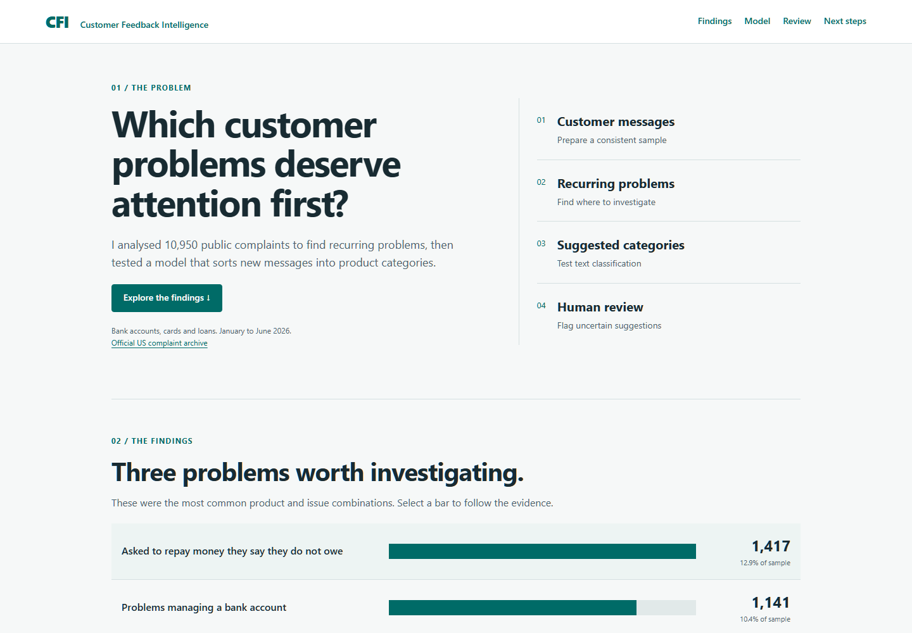
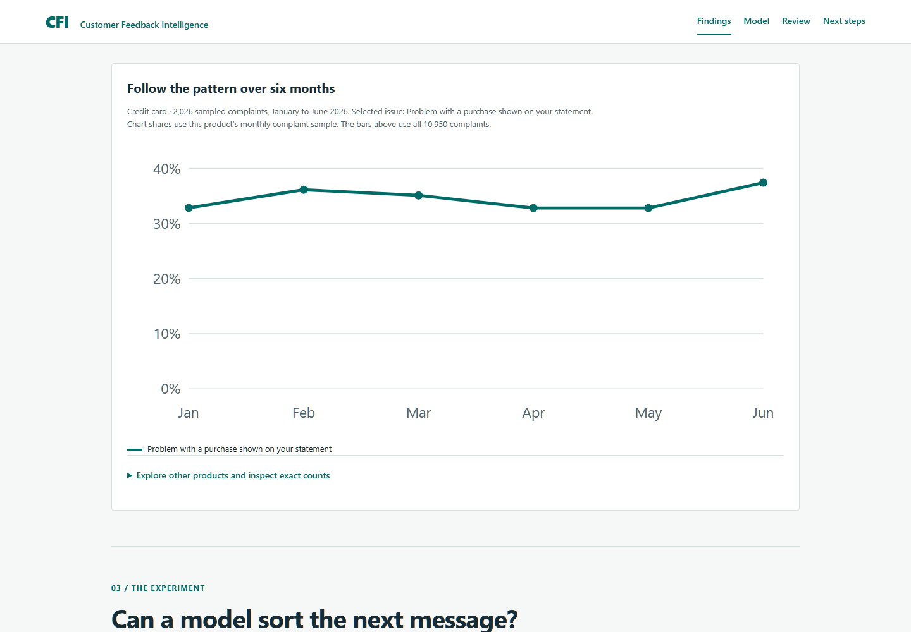
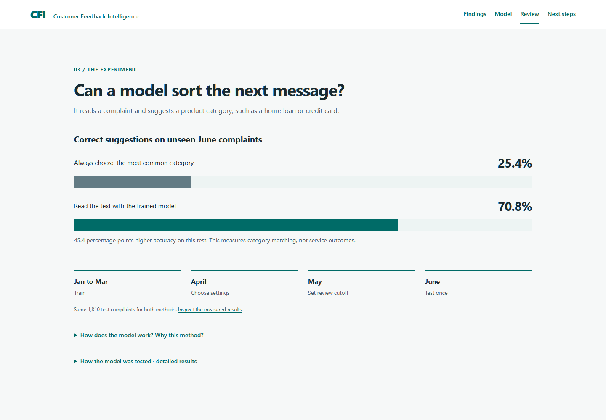
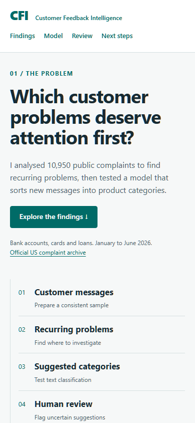
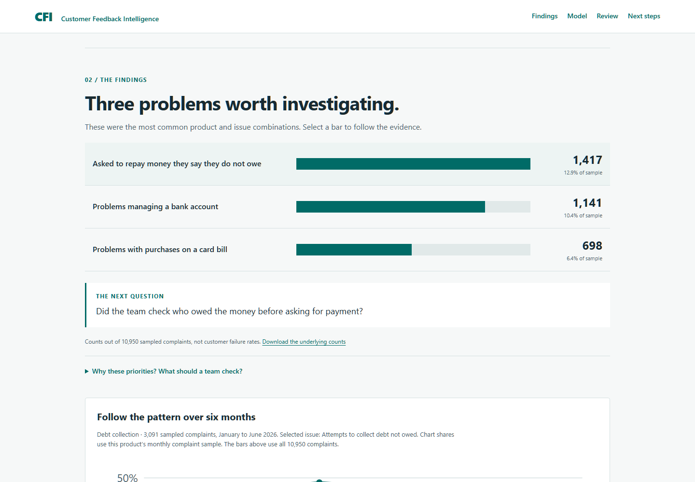
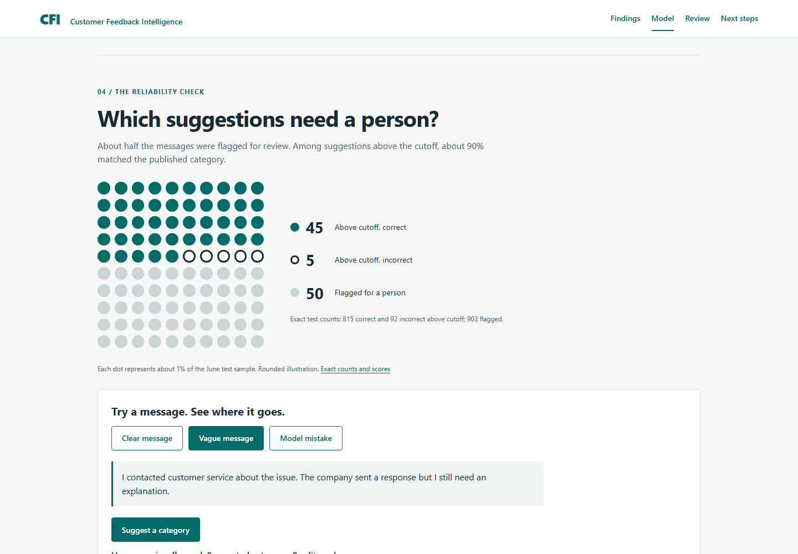

# Product and code review — 12 October 2026

The product is now a guided customer-feedback research case study. It retains the frozen real-data analysis and model results, while explaining the problem before introducing terminology or metrics.

## Reading flow and review outcome

| Step | Previous obstacle | Change | Status |
|---|---|---|---|
| 1. Understand the problem | Acronyms, technical metrics and disclaimers appeared before the reader understood the task. | A plain-language customer-service scenario distinguishes investigation from message classification; a short source explanation defines the dataset. | Implemented |
| 2. Choose a finding | Long official issue labels and repeated methodological prose made the priorities difficult to scan. | Everyday titles, one investigation question per finding, and expandable supporting evidence. | Implemented |
| 3. Follow the evidence | All finding links jumped to an unfiltered chart. The issue table ignored the selected issue. | Finding links set both filters and move keyboard focus to the evidence heading. Chart, summary and count table share the selected scope. | Implemented and exercised |
| 4. Understand the model | Macro-F1 and split terminology dominated the first view. The model example appeared after several tables. | A baseline-versus-model bar chart, an explanation in counts out of 100, four illustrative examples, and detailed results available on demand. | Implemented and exercised |
| 5. Inspect uncertainty | Only eight review rows were reachable. Scores could be mistaken for probabilities. | Pagination through all 100 exported preview cases; clear scope and score definitions; a model mistake is demonstrated explicitly. | Implemented and exercised |
| 6. Understand the value | The audience had to infer the link from results to a service decision. | A final chapter explains human case review, a possible controlled pilot, tool choices and research sources. | Implemented; operational impact remains unmeasured |

## Code findings

- **Correctness, fixed:** `insights.py` assigned specific recommendations to numeric ranks. A different ranking could attach debt guidance to another issue. Guidance is now keyed by product and issue; a regression test checks it against the frozen report and an unfamiliar issue.
- **Resilience, fixed:** failure to load the optional example model previously prevented the whole dashboard from loading. The findings and measured results now remain available, with the example button disabled and an explanation. A missing study snapshot offers a retry and a readable findings link.
- **Performance, improved:** replaced the 1,191,749-byte chart library with responsive SVG for six-point monthly series. Main page assets decreased from 1,491,763 bytes to approximately 329 KB, about 78% uncompressed. This excludes downloadable reports and is not a claim about transfer compression, loading time, or Core Web Vitals.
- **Accessibility, improved:** labelled and keyboard-focusable table regions, minimum-height controls, distinct line styles as well as colours, text/table alternatives, filter announcements, and reduced-motion support. These checks do not constitute a complete screen-reader or WCAG audit.
- **Maintainability, retained:** static HTML/CSS/JavaScript, a compact exported model, Python/DuckDB preparation, and the existing locked tooling. No frontend framework or paid service was needed.

## Sensible next work

1. Have a person unfamiliar with the project explain the problem, one finding, and the model trade-off after reading. Record misunderstandings before adding more features. No timed usability claim has been made.
2. Independently review a bounded sample of category disagreements. The published labels are useful references, not an adjudicated gold standard.
3. For a new experiment, evaluate rare categories and semantic features on a new held-out period. Do not tune repeatedly against the already-opened June test.
4. If the project grows, split the client renderer by chapter, validate the exported JSON schema at the boundary, and centralize the duplicated fixed example text. These are maintenance opportunities, not reasons to add a framework now.
5. Replace the manual report-to-site copy step with a single documented export command when the analytical snapshot is next rebuilt. Existing tests already enforce report/download equality.

## Evidence and boundaries

The audit used the live page, current-run screenshots, source inspection, browser interactions, and repository checks. Local Ruff and 13 pytest tests passed. The first revised build passed Linux CI, including public-data tests, desktop/mobile flows, model parity, missing-file states and Docker build/run. Two private-reproduction tests run locally and are intentionally skipped in public CI.

The analytical snapshot was not retrained or retuned. The measured result remains 70.8% category accuracy versus a 25.4% majority baseline on 1,810 June records. Above the preselected score cutoff, 815/907 predictions matched; 903/1,810 were flagged for review. No reduction in complaints, handling time or costs has been measured.

## Current presentation

See the [plain-language walkthrough](../demo_script.md), [CV evidence](../cv_evidence.md), [research ledger](../research.md), and [validation record](../validation.md).

## Five-scene refinement, October 12, 2026

The introductory essay and metric strip were replaced by a concise purpose statement and workflow diagram. Three directly labelled count bars now select the investigation question and monthly evidence. Model accuracy and review coverage are separate scenes: the 100-dot illustration derives from the frozen test counts, not a new experiment. Fixed example buttons reveal a clear case, a vague case and a mistake. Research, sampling, tools, operational proposals and detailed metrics remain accessible through disclosures. Public copy uses no em dashes.

Validation: 13 local pytest tests, Ruff checks, desktop 1440×1000 and mobile 390×844 browser flows passed. The browser checks include all three bars, filters/reset, exact 45/5/50 dot counts, example buttons, four-example inference parity, review pagination, load-failure recovery, no page overflow and no JavaScript errors. Repository evidence links and section links were checked against the checkout. Screenshots below were refreshed from this run. No user-study comprehension or measured operational effect is claimed.

